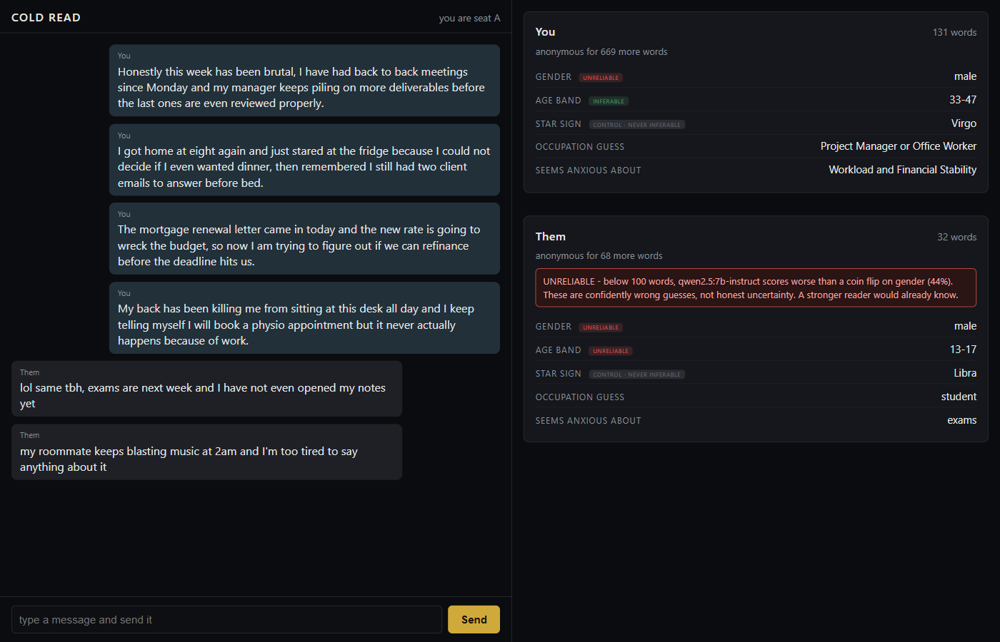

# COLD READ

[](docs/media/hero-loop.mp4)

[](https://doi.org/10.5281/zenodo.22309660)
[](LICENSE)

"You are identifiable after N words" cannot be finished without naming the model that reads you.
Four local language models were shown the same 72 bloggers in growing slices (25 to 1600 words)
and asked for gender, age band and star sign every time; the number of words each needed to beat
a coin flip differed widely between models, while the star sign control, which cannot be inferred
from style, never cleared its bar. One part of that result did not hold up: the headline "32x
spread" in gender was mostly a prompt habit. A rerun with every author asked under both option
orders (2026-11-18) puts the gender half-lives at 25, 100 and 50 words, and the gap between
readers appears only when "female" is listed first (see
[Where the result is weaker than it was written](#where-the-result-is-weaker-than-it-was-written)).

It is for anyone who quotes a word-count threshold for anonymity, and for anyone who wants to run
the same sweep on another model. It needs a local [Ollama](https://ollama.com) with the models
pulled. The corpus (Blog Authorship Corpus, Schler et al., AAAI Spring Symposium 2006; Hugging
Face `tasksource/blog_authorship_corpus`, non-commercial research use) is gitignored and not
redistributed.

```
python build_sample.py                          # balanced 72-author sample, seed 1938
python sweep.py --model qwen2.5:7b-instruct     # 504 calls, resumable, appends to out/
python analyze.py out/results-qwen2.5_7b-instruct.jsonl
python -m pytest -q                             # no model needed; reads the committed results
```

Raw per-call results for every reader are committed under `out/`, so every table below
regenerates with `analyze.py` without a model call.

## The measurement

For each author and each word count in 25, 50, 100, 200, 400, 800, 1600, the model sees that
author's first N words and must answer; refusal and "unknown" are not allowed, because an
abstention would bend the curve down at the low word counts. Temperature 0, seed 1938.

| Term | Meaning (`analyze.py`) |
|---|---|
| Bar | the best constant guess on the sample: gender 50.0%, age band 33.3%, star sign 15.3%, industry 25.0% |
| Half-life | the first grid cell whose Wilson 95% lower bound is above the bar; no interpolation, so 2x resolution |
| Control | star sign: labelled in the corpus, not inferable from style, same pipeline. If it ever cleared, the pipeline leaks |

Seven grid cells are seven comparisons per curve, uncorrected for multiplicity: with independent
steps the chance a null curve clears somewhere is about 16% (1 - 0.975^7, computed, not
simulated). No paired test between readers is in the study.

## Results

Runs 2026-08-23 to 2026-10-06, all Q4_K_M via Ollama, regenerated 2026-11-13 with `analyze.py`.
Half-life in words; "never" means it did not clear within 1600.

| Reader (params) | Gender half-life, crossed order | Gender half-life, original (withdrawn) | Gender at 1600, original | Age band half-life | Age at 1600 | Sign (control) | Industry half-life |
|---|---|---|---|---|---|---|---|
| llama3.1:8b (8.0B) | 25 | 50 | 90.3% | 25 | 59.7% | never | 25 |
| qwen2.5:7b-instruct (7.6B) | 100 | 800 | 72.2% | 100 | 58.3% | never | 50 |
| mistral:7b (7.2B) | 50 | 1600 | 63.9% | 25 | 70.8% | never | 50 |
| llama3.2 (3.2B) | not rerun | never | 61.1% | 100 | 63.9% | never | 200 (27 of 504 unparsed) |

The crossed column asks every author under both option orders (2026-11-18, `RESULT.md` step 4);
the other columns are the original runs. Full per-step tables with intervals: [`RESULT.md`](RESULT.md). The industry attribute (adults only,
four industries, a different 72 authors, 25% bar) and its topic-word masking test are in the last
two sections of `RESULT.md`; masking about 1.6% of words moved the half-life one grid step
(llama 25 to 50, qwen 50 to 100) and left the plateau within 5 points, which is inside the noise
at n = 72. It does not show that style alone carries industry.

What survived across readers, each a result of the committed `out/` files:

- **The control held** in every reader and every attribute: star sign never cleared its bar.
- **Readers differ, under one prompt order.** At 1600 words llama3.1:8b leads on crossed gender
  accuracy (0.924 against 0.792 and 0.701), but only when "female" is listed first; with "male"
  first the three are not separable.
- **Exposure accrues.** The curves climb; none snaps on at a threshold.
- **Size matters inside a family**, in the original runs only: llama3.2 (3.2B) never clears gender,
  llama3.1 (8.0B) clears at 50 (the two are also different releases, and the 3B reader was not
  rerun with the crossed order).
- **Memorisation was probed**, with a different-author control, and the recorded gap was
  negligible. Numbers for this are unverified (see [Status](#status)).

What did not survive, kept in the record on purpose:

- **Below-chance dip on gender.** Qwen and mistral read 44.4% at 25 words, llama3.1 59.7%. In no
  reader does the interval exclude 0.50, and the option-order bias below explains it better than
  "stereotype matching". It is an observation, not a finding.
- **A shared age ceiling near 60%.** Qwen and llama3.1 sat at 58.3% and 59.7%; mistral reaches
  70.8% at 1600 and is still climbing. Withdrawn.
- **One ranking of readers.** Mistral is slowest on gender and tied fastest on age band.

## Where the result is weaker than it was written

Found by an external red-team pass of the public repo (2026-11-10; findings and scripts in `redteam-2026-11-10/`) and re-checked here on
2026-11-13 against the committed `out/*.jsonl` and `sweep.py`. No result file changed.

- **Option order drives gender accuracy.** `sweep.py::option_order` lists "male" first for 38
  authors and "female" first for 34. With female listed first, mistral answered "female" for all 34
  authors at 1600 words (14 of 34 correct, the share of women among them), against 32 of 38 correct
  when male was listed first. Qwen at 1600 words: 18 of 34 against 34 of 38. Qwen picks the
  first-listed gender for 66 of 72 authors at 25 words, and a first-option picker scores 30 of
  72 = 41.7% there (observed 44.4%). So the gender half-lives of 800 and 1600 partly measure a
  prompt-position habit, and the **"32x" gap is not established as a magnitude**. Reader differences
  in the weak sense (llama3.1:8b beats the others) are not undone by this, but the size of the gap is.
- **Counterbalancing is not balanced against the truth.** Truth is the first-listed option for 30 of
  72 authors, so the bias is averaged in, not removed.
- **Age before gender in llama3.1:8b rests on one hit.** Age clears at 25 words (lower bound 0.3354
  against a 0.3333 bar) and falls under the bar again at 50, where gender clears.
- **Masked industry runs fall under the bar at 200 words** for both readers; their sustained
  crossing is later than the half-life reported.
- **The live app states the withdrawn claim.** `index.html` tells a user under 100 words that the
  reader "scores worse than a coin flip on gender (44%)". Source was not changed in this pass.
  Fixed 2026-11-18: the app now shows the option-order warning instead.
- **The 3B "constant predictor" claim.** `RESULT.md` says 157 of 157 "male"; the committed archive
  file (`out/archive/results-qwen2.5_3b-instruct-PREBALANCE.jsonl`) holds 178 of 178 "male" on 26
  authors, all run before counterbalancing, and it was never re-run with the current prompt.
- **The rerun with a fully crossed order is done (2026-11-18, `RESULT.md` step 4).** Design and
  verdict rule were committed before the first call; 1,008 fresh calls per reader, 0 unparsed.
  Crossed gender half-lives: llama3.1:8b 25 words, qwen2.5:7b 100, mistral:7b 50 (was 50, 800,
  1600), so the "32x" spread is withdrawn. At 1600 words llama3.1:8b still leads on crossed gender
  accuracy (0.924 against 0.792 and 0.701; differences +0.132 [+0.049, +0.208] and +0.222 [+0.118,
  +0.326], 97.5% intervals), but with "male" listed first the three readers are not separable (66,
  65 and 63 of 72). Verdict under the pre-registered rule: prompt-conditional. The gender gap is a
  property of the reader and the prompt. Age band shows no reader gap. Star sign never clears.
  Not rerun: the 3B and 70B readers, so the size comparison still carries the confound.

## The artifact and its ethics rule

`python server.py`, then open `?seat=a` and `?seat=b`. A two-seat chat in which both people consent;
after each message the sender is re-profiled from everything they have typed, and both seats see both
profiles fill in. Star sign is always shown, marked as the control. It reads only text a person typed
into it in that session; the server returns 403 until both seats have consented, and nothing is stored
when it stops. The app does not infer industry. Its thresholds are the qwen2.5:7b numbers and the
interface names that model.



Screenshot of a real session on 2026-08-23.

## Architecture

| Part | File | Role |
|---|---|---|
| Sampler | `build_sample.py` | 72 authors, 12 per age x gender cell, seed 1938 |
| Sweep | `sweep.py` | one call per (author, word count); resumable JSONL in `out/`; also `--provider openrouter` with a spend cap |
| Analysis | `analyze.py` | accuracy, Wilson intervals, best-constant bars, half-life; `--json` for structured output |
| Probe | `contamination_check.py` | verbatim 50-word prefix, model continues, trigram overlap with the true vs a different author's next 50 words |
| Masking | `topicmask.py` | industry word lexicon (about 150 stems) for step 3b |
| App | `server.py`, `index.html` | the two-seat chat |

Details, failure modes and the scaling plan: [`docs/ARCHITECTURE.md`](docs/ARCHITECTURE.md).
Pre-registered design and decision log: [`PLAN.md`](PLAN.md).

## Prior work

Argamon, Koppel, Pennebaker and Schler (*Automatically profiling the author of an anonymous text*,
CACM 2009) profiled age and gender on this corpus statistically; Eder (*Does size matter?*, DSH
2015) swept sample length for authorship attribution with one method; Staab et al.
([arXiv:2310.07298](https://arxiv.org/abs/2310.07298)) measured LLM attribute inference; Lermen et
al. ([arXiv:2602.16800](https://arxiv.org/abs/2602.16800)) showed large-scale profile linkage.
None sweeps input size across several readers, which is the gap this study addressed, subject to
the confound above.

## How it is tested

`python -m pytest -q`: 35 passed (2026-11-18, Windows 11, Python 3.14). The tests check that the
committed JSONL reproduces the half-lives and tables, that the star sign control never clears, the
industry and masking results, the OpenRouter provider and the topic mask. They do not call a model.
CI (`.github/workflows/ci.yml`) runs the same on Python 3.12.

## Status

Measurement closed at n = 72 authors, four readers, one corpus (self-reported 2004 blog labels).
Archived as Zenodo v1.5.0 (DOI above, `CITATION.cff` 2026-11-18), which carries the crossed-order
rerun and the new title. Versions up to v1.4.0 state the withdrawn 32x gender spread.

Unverified in this repository: the contamination result (+0.0021 mean trigram overlap, gap against
control, 20 authors, qwen only) has no raw output committed, and `contamination_check.py` could not
be rerun on 2026-11-13 because `qwen2.5:7b-instruct` is not pulled on this machine. The 20 probed
authors are the first 20 in the sample and all are aged 13-17. The claim that 6 of 72 authors
mention star-sign or birthday terms also has no committed source text. Treat both as not verified.

## Limits

- 72 authors, so intervals are wide; read a gender half-life as "high hundreds of words or more",
  and mistral's 1600 as the narrowest pass (46 of 72, lower bound 0.5235).
- Readers span 7.2B to 8.0B plus one 3.2B model, one quantisation, Ollama only. Ollama at temperature
  0 and a fixed seed is not fully deterministic here: a full qwen industry re-run changed 25 of 504
  predictions, llama3.1:8b changed 0.
- Demographic attributes plus industry only. Income, location and employer are not tested and not
  claimed.
- No paired test between readers; multiplicity uncorrected.

## License

Code is MIT ([LICENSE](LICENSE)). The written analysis and experimental design are the Zenodo record,
CC BY 4.0; cite it, do not copy the text:

> Syed, Z. A. (2026). *COLD READ: The Anonymity Half-Life Depends on the Reader and the Prompt*.
> Zenodo. https://doi.org/10.5281/zenodo.22309660

Metadata in [`CITATION.cff`](CITATION.cff). ORCID
[0009-0003-4313-1510](https://orcid.org/0009-0003-4313-1510). Commits are signed with ed25519 key
`EFE9 4832 B2B9 80D9 B583 91F2 8FAA BCC1 B1AC 09E5`; 30 of 38 commits show a valid signature locally
(`git log --format=%G?`), 8 do not, including the one holding the first gate and qwen data.
